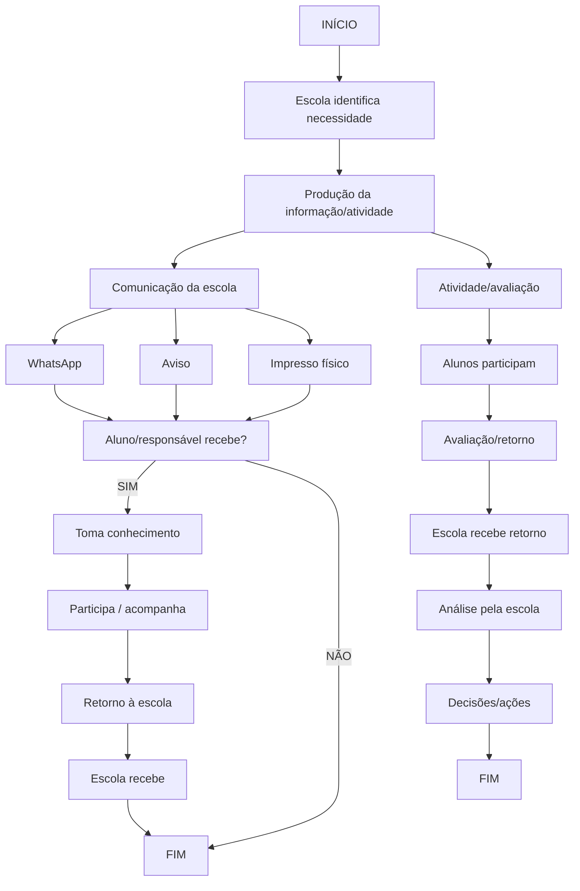
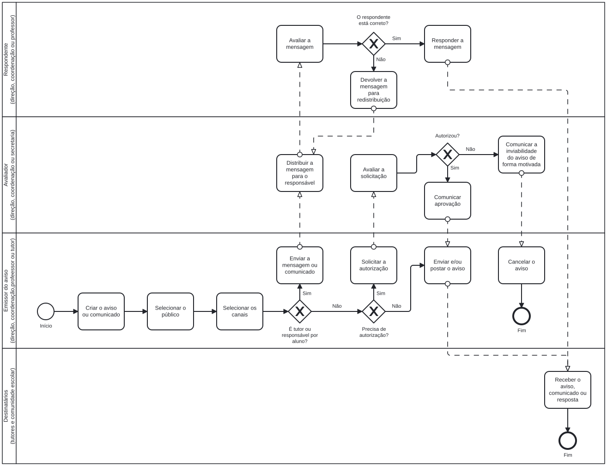

UNIVERSIDADE DE BRASÍLIA

FACULDADE DE TECNOLOGIA / INSTITUTO DE CIÊNCIAS EXATAS

DEPARTAMENTO DE CIÊNCIA DA COMPUTAÇÃO

CIC0101 - SISTEMAS DE INFORMAÇÃO - TURMA 02 - 2026/2

PROFA. DRª. PATRÍCIA ARAÚJO DE OLIVEIRA

Grupo: 01

Integrantes: Luan, Leonardo, Calebe, Maíra

Título / situação-problema: Quadro Digital de avisos / Falhas na comunicação escolar

# Entrega 1

## Problema, contexto e justificativa

### Contexto da situação-problema:

A comunicação entre os membros da comunidade escolar é realizada atualmente por diferentes meios, como grupos de WhatsApp, quadros de avisos físicos distribuídos pela escola e comunicados enviados aos responsáveis. Esses canais funcionam de forma descentralizada, sem uma padronização do fluxo de comunicação. Como resultado, informações importantes nem sempre chegam aos destinatários corretos ou são recebidas em tempo hábil, dificultando a participação dos pais na vida escolar dos alunos e prejudicando a divulgação de informações relevantes pela escola.

### Problema ou oportunidade claramente delimitado:

A escola enfrenta dificuldades para garantir que informações institucionais, pedagógicas e administrativas sejam distribuídas de forma organizada, tempestiva e acessível para todos os membros da comunidade escolar. A ausência de um processo estruturado de comunicação reduz a eficácia dos avisos e dificulta o acompanhamento das atividades escolares por alunos e responsáveis.

### Evidências, manifestações e consequências observadas:

- Avisos importantes são perdidos em meio ao grande volume de mensagens dos grupos de WhatsApp.
- Nem todos os membros da comunidade escolar participam dos grupos existentes.
- Comunicados em quadros de avisos físicos possuem alcance limitado e dependem da presença do destinatário na escola.
- Responsáveis que trabalham possuem dificuldades para acompanhar as informações escolares.
- Há incerteza sobre quem recebeu ou tomou conhecimento de determinados avisos.
- O acompanhamento da vida escolar dos alunos ocorre de maneira fragmentada, exigindo consulta a diferentes canais de informação.

### Justificativa (motivo do problema/oportunidade ser relevante):

A comunicação eficiente é essencial para o funcionamento das atividades escolares e para o fortalecimento da relação entre escola, alunos e responsáveis. Problemas de comunicação podem causar perda de prazos, baixa participação em eventos, dificuldade de acompanhamento do desempenho escolar e redução do engajamento das famílias. Melhorar esse processo contribui para aumentar a transparência institucional, fortalecer a participação da comunidade escolar e apoiar a gestão das atividades educacionais.

## Revisão crítica da formulação do problema

|Sintomas / manifestações | Possíveis causas / hipóteses | Soluções já imaginadas |
|-|-|-|
|Avisos não chegam aos destinatários ou chegam com atraso | Utilização de múltiplos canais de comunicação sem coordenação central | Centralizar a divulgação das informações em um único ambiente |
| Mensagens importantes se perdem em grupos de WhatsApp | Excesso de mensagens e ausência de categorização adequada | Organização dos comunicados por tipo e público-alvo |
| Pais possuem dificuldades para acompanhar a rotina escolar dos filhos | Dependência de canais informais e descentralizados | Disponibilizar acompanhamento integrado de informações escolares |
| Direção e coordenação têm dificuldade em controlar a divulgação dos comunicados | Ausência de fluxo formal de publicação e aprovação | Estabelecer processo de moderação e validação dos avisos |
| Não há confirmação sobre quem recebeu ou visualizou informações importantes | Falta de mecanismos de acompanhamento da comunicação | Registro de recebimento e leitura das mensagens |

> Teste: reescrevam o problema sem mencionar aplicativo, plataforma, sistema, IA, banco de dados ou outra tecnologia

A escola possui dificuldades para organizar e distribuir informações de forma eficiente entre direção, coordenação, professores, alunos e responsáveis. Os canais atualmente utilizados não garantem que os comunicados alcancem os destinatários corretos no momento adequado, comprometendo o acompanhamento das atividades escolares, a participação das famílias e a efetividade da comunicação institucional.

> Se retirarmos a solução tecnológica, o problema continua existindo? 

☒ Sim      
☐ Não (reformular)

## Objetivos

### Objetivo geral:

Desenvolver um sistema de informação que centralize e facilite a comunicação entre a comunidade escolar, promovendo maior eficiência na troca de informações entre a direção, professores da instituição e os responsáveis e alunos, por meio da disponibilização de avisos, notas, frequências, declarações e canais de contato

### Objetivos específicos:

1. Reduzir a perda e a dispersão de informações na comunicação entre a escola, os responsáveis e os alunos;
2. Disponibilizar uma plataforma centralizada e de fácil acesso para consulta de informações e indicadores acadêmicos;
3. Reduzir o tempo de resposta às solicitações encaminhadas à área administrativa da escola;
4. Promover um canal de comunicação para o envio de feedbacks, dúvidas e solicitações por parte dos responsáveis e alunos.

### Como os objetivos se relacionam com o problema delimitado?

Os objetivos estão diretamente relacionados ao problema delimitado, pois buscam solucionar as principais dificuldades de comunicação e acesso às informações existentes no ambiente escolar. Os objetivos contribuem para tornar a comunicação entre direção, professores, alunos e responsáveis mais organizada, ágil e eficiente.

## Visão sistêmica e sociotécnica (consolidação)

| Elemento | Aplicação à situação do grupo |
|-|-|
| Sistema/foco de análise | Processo de comunicação entre a escola e a comunidade escolar |
| Ambiente e elementos externos | Famílias dos alunos, instituições de ensino, calendário escolar, eventos externos |
| Fronteira considerada | Comunicação institucional entre direção, coordenação, secretaria, professores, alunos e responsáveis |
| Principais entradas | Avisos, notas, frequência, calendário escolar, mensagens, solicitações de responsáveis |
| Processamento/transformações relevantes | Produção de informação, aprovação de solicitações, categorização de informações, distribuição de comunicações e acompanhamento das informações |
| Principais saídas | Comunicados entregues, notificações, relatórios, consulta de notas e frequência |
| Pessoas/papéis já identificados | Direção, coordenação, secretaria, professores, alunos e responsáveis |
| Processos envolvidos | Comunicação institucional, divulgação de avisos, registro de notas, registro de frequência e atendimento a solicitações |
| Dados/informações relevantes | Cadastro de usuários, níveis de acesso, avisos, notas, frequência, calendário escolar, mensagens e registros de atividades |
| Tecnologias atualmente utilizadas | WhatsApp, quadros de avisos físicos e comunicados impressos |

> Articulação sociotécnica: expliquem como pessoas, processos, dados/informações e tecnologia se relacionam na situação analisada e como uma mudança em uma dimensão pode afetar as demais.

A situação analisada envolve a interação entre pessoas, processos, informações e tecnologias. Direção, coordenação, secretaria, professores, alunos e responsáveis participam de processos de comunicação que dependem do compartilhamento adequado de informações. Atualmente, as tecnologias utilizadas não oferecem mecanismos suficientes para organizar e monitorar essas comunicações. Alterações nos processos de divulgação impactam diretamente a qualidade das informações disponíveis para os usuários. Da mesma forma, melhorias no tratamento das informações e nas tecnologias de apoio podem aumentar a eficiência da comunicação, o engajamento dos responsáveis e a capacidade de gestão da escola.

## Processo organizacional (representação AS-IS consolidada)

### Descrição em forma de diagrama do processo atual de disseminação de informações na comunidade escolar:

<!-- Para visualizar o diagrama, use a extensão Markdown Preview Mermaid Support-->

### Interpretação:

O problema aparece principalmente nas etapas de divulgação e recebimento das informações. Após a criação de um aviso pela direção, coordenação ou professores, a comunicação é realizada por múltiplos canais, como WhatsApp, quadros de avisos e comunicados impressos. Nesse momento ocorrem perdas de informação, atrasos e dificuldade de confirmação do recebimento pelos destinatários.

Além disso, não existe um mecanismo padronizado para acompanhar a efetividade das comunicações. O mesmo ocorre no fluxo relacionado às notas e frequência dos alunos, cujo acompanhamento pelos responsáveis depende de diferentes formas de comunicação e nem sempre acontece em tempo adequado. Esses fatores reduzem a eficiência do processo e comprometem o alcance dos objetivos da comunicação escolar.

## Dados e informação (consolidação do mini-workshop)

| Dado / informação | Origem | Onde aparece no processo? | Quem usa/produz? | Finalidade |
|-|-|-|-|-|
| Avisos e comunicados escolares | Direção, coordenação e professores | Na produção e divulgação das informações | Direção, coordenação, professores, alunos e responsáveis | Informar sobre atividades, eventos, reuniões, mudanças e outros comunicados da escola |
| Calendário escolar e eventos | Direção e coordenação | Durante o planejamento e divulgação das atividades | Direção, coordenação, professores, alunos e responsáveis | Organizar e informar datas de aulas, eventos, reuniões, avaliações e atividades |
| Notas e frequência dos alunos | Professores e secretaria | Durante o registro e acompanhamento da vida escolar | Professores, secretaria, alunos e responsáveis | Permitir o acompanhamento do desempenho e da frequência dos alunos |
| Mensagens e registros de comunicação | Membros da comunidade escolar | Durante os fluxos de comunicação entre os participantes | Direção, coordenação, professores, alunos e responsáveis | Registrar e facilitar a comunicação e o acompanhamento das informações |

### Problema de qualidade já identificado:

Foram identificados problemas relacionados à perda, atraso e fragmentação das informações. Avisos importantes podem se perder em meio ao grande volume de mensagens, nem todos os membros da comunidade escolar participam dos canais utilizados e há incerteza sobre o recebimento ou visualização de determinados avisos. Além disso, o acompanhamento das informações ocorre de forma fragmentada entre diferentes canais.

## Delimitação inicial

### Dentro do escopo:

Analisar e conceber uma rede social escolar voltada inicialmente para instituições de ensino fundamental, com foco na melhoria da comunicação entre direção, coordenação, professores, alunos e responsáveis. O projeto abrangerá a organização e divulgação de avisos escolares, o compartilhamento de informações sobre atividades e eventos, o acompanhamento da comunicação escolar e a integração da comunidade escolar em um ambiente centralizado.

### Fora do escopo:

Ficam fora do escopo sistemas administrativos e de gestão interna da escola, como controle financeiro, gestão de funcionários, matrícula e administração de recursos. O projeto também não tem como objetivo substituir os processos pedagógicos e administrativos existentes, mas oferecer um meio de interação, avaliação, acompanhamento e retorno entre a escola e a comunidade escolar.

## Questões em aberto para as próximas entregas

Será necessário compreender melhor o funcionamento dos processos administrativos de uma escola, identificando as principais demandas de comunicação entre a direção, professores, alunos e responsáveis. Também será necessário definir a melhor forma de organizar e divulgar as informações, garantindo que elas sejam direcionadas às pessoas corretas e disponibilizadas em tempo hábil, sem gerar um fluxo excessivo ou desnecessário de informações. Além disso, será importante identificar quais funcionalidades e tipos de informações devem ser priorizados no sistema.

# Entrega 2

## Retomada e atualização da Entrega 1

> Mantenham no relatório: (1) problema, contexto, justificativa e objetivos; (2) distinção entre sintomas, hipóteses de causa e soluções imaginadas; (3) visão sistêmica/sociotécnica; (4) processo AS-IS e sua interpretação; (5) dados e informações iniciais; (6) escopo e questões em aberto. Atualizem apenas o que mudou com o aprofundamento do projeto.

Não foram observadas mudanças nas características apresentadas na Entrega 1 do projeto
integrador.

## Stakeholders e necessidades

> Identifiquem quem participa, usa, fornece informações, decide ou é afetado pelo processo e pela futura solução. Para cada stakeholder, registrem a necessidade associada ao problema e a evidência ou origem dessa necessidade. Não confundam necessidade com funcionalidade pronta.

Para além dos fluxos de comunicação desordenados explicados na Entrega 1, o fluxo que os
comunicados devem seguir, consta no fluxograma a seguir:

