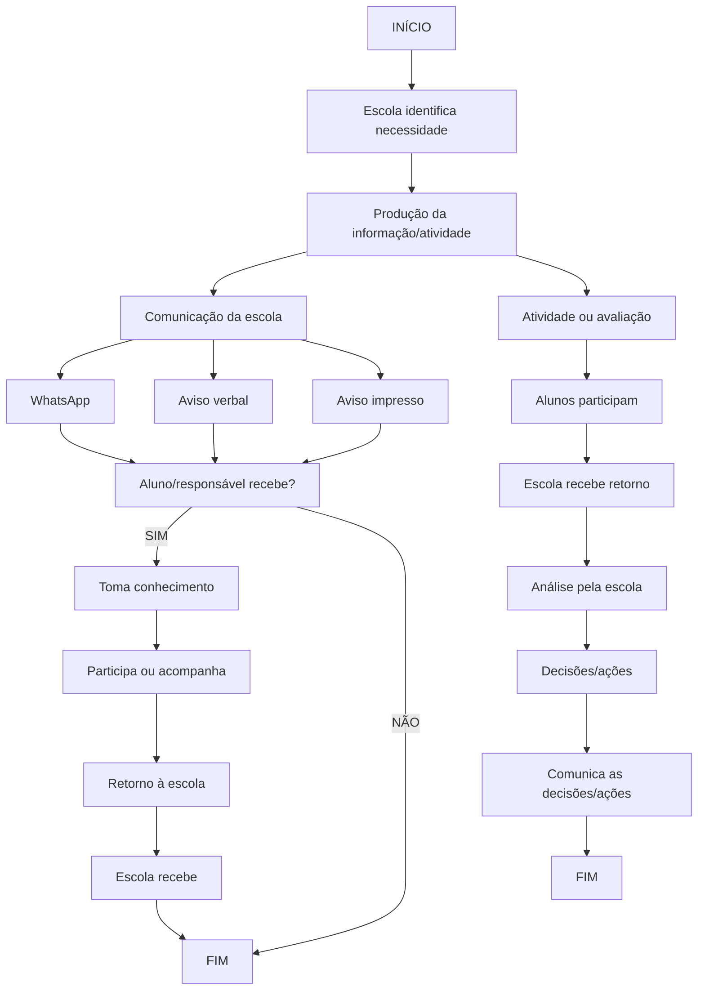
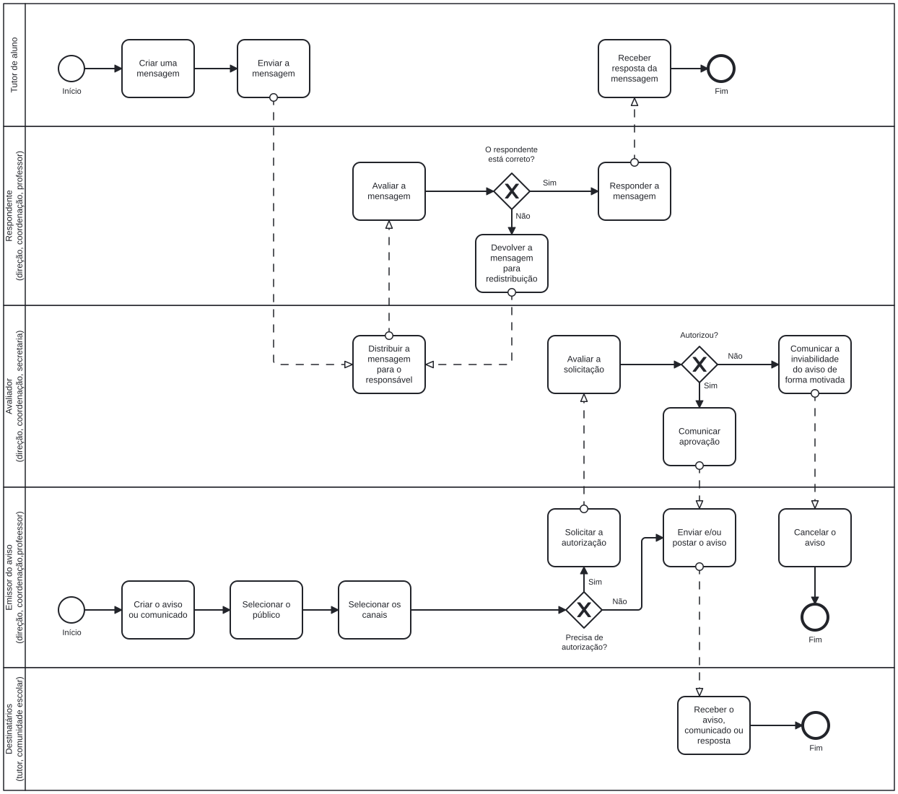

UNIVERSIDADE DE BRASÍLIA  
FACULDADE DE TECNOLOGIA / INSTITUTO DE CIÊNCIAS EXATAS  
DEPARTAMENTO DE CIÊNCIA DA COMPUTAÇÃO  
CIC0101 - SISTEMAS DE INFORMAÇÃO - TURMA 02 - 2026/2  
PROFA. DRª. PATRÍCIA ARAÚJO DE OLIVEIRA  

Grupo: 01  
Integrantes:  
Luan Moura  
Leonardo  
Calebe  
Maíra  

Título / situação-problema: Quadro Digital de avisos / Falhas na comunicação escolar

# Entrega 1

## Problema, contexto e justificativa

### Contexto da situação-problema:

A comunicação entre os membros da comunidade escolar é realizada atualmente por diferentes meios, como grupos de WhatsApp, quadros de avisos físicos distribuídos pela escola e comunicados enviados aos responsáveis. Esses canais funcionam de forma descentralizada, sem uma padronização do fluxo de comunicação. Como resultado, informações importantes nem sempre chegam aos destinatários corretos ou são recebidas em tempo hábil, dificultando a participação dos pais na vida escolar dos alunos e prejudicando a divulgação de informações relevantes pela escola.

### Problema ou oportunidade claramente delimitado:

A escola enfrenta dificuldades para garantir que informações institucionais, pedagógicas e administrativas sejam distribuídas de forma organizada, tempestiva e acessível para todos os membros da comunidade escolar. A ausência de um processo estruturado de comunicação reduz a eficácia dos avisos e dificulta o acompanhamento das atividades escolares por alunos e responsáveis.

### Evidências, manifestações e consequências observadas:

- Avisos importantes são perdidos em meio ao grande volume de mensagens dos grupos de WhatsApp.
- Nem todos os membros da comunidade escolar participam dos grupos existentes.
- Comunicados em quadros de avisos físicos possuem alcance limitado e dependem da presença do destinatário na escola.
- Responsáveis que trabalham possuem dificuldades para acompanhar as informações escolares.
- Há incerteza sobre quem recebeu ou tomou conhecimento de determinados avisos.
- O acompanhamento da vida escolar dos alunos ocorre de maneira fragmentada, exigindo consulta a diferentes canais de informação.

### Justificativa (motivo do problema/oportunidade ser relevante):

A comunicação eficiente é essencial para o funcionamento das atividades escolares e para o fortalecimento da relação entre escola, alunos e responsáveis. Problemas de comunicação podem causar perda de prazos, baixa participação em eventos, dificuldade de acompanhamento do desempenho escolar e redução do engajamento das famílias. Melhorar esse processo contribui para aumentar a transparência institucional, fortalecer a participação da comunidade escolar e apoiar a gestão das atividades educacionais.

## Revisão crítica da formulação do problema

|Sintomas / manifestações | Possíveis causas / hipóteses | Soluções já imaginadas |
|-|-|-|
|Avisos não chegam aos destinatários ou chegam com atraso | Utilização de múltiplos canais de comunicação sem coordenação central | Centralizar a divulgação das informações em um único ambiente |
| Mensagens importantes se perdem em grupos de WhatsApp | Excesso de mensagens e ausência de categorização adequada | Organização dos comunicados por tipo e público-alvo |
| Pais possuem dificuldades para acompanhar a rotina escolar dos filhos | Dependência de canais informais e descentralizados | Disponibilizar acompanhamento integrado de informações escolares |
| Direção e coordenação têm dificuldade em controlar a divulgação dos comunicados | Ausência de fluxo formal de publicação e aprovação | Estabelecer processo de moderação e validação dos avisos |
| Não há confirmação sobre quem recebeu ou visualizou informações importantes | Falta de mecanismos de acompanhamento da comunicação | Registro de recebimento e leitura das mensagens |

> Teste: reescrevam o problema sem mencionar aplicativo, plataforma, sistema, IA, banco de dados ou outra tecnologia

A escola possui dificuldades para organizar e distribuir informações de forma eficiente entre direção, coordenação, professores, alunos e responsáveis. Os canais atualmente utilizados não garantem que os comunicados alcancem os destinatários corretos no momento adequado, comprometendo o acompanhamento das atividades escolares, a participação das famílias e a efetividade da comunicação institucional.

> Se retirarmos a solução tecnológica, o problema continua existindo? 

☒ Sim      
☐ Não (reformular)

## Objetivos

### Objetivo geral:

Desenvolver um sistema de informação que centralize e facilite a comunicação entre a comunidade escolar, promovendo maior eficiência na troca de informações entre a direção, professores da instituição e os responsáveis e alunos, por meio da disponibilização de avisos, notas, frequências, declarações e canais de contato

### Objetivos específicos:

1. Reduzir a perda e a dispersão de informações na comunicação entre a escola, os responsáveis e os alunos;
2. Disponibilizar uma plataforma centralizada e de fácil acesso para consulta de informações e indicadores acadêmicos;
3. Reduzir o tempo de resposta às solicitações encaminhadas à área administrativa da escola;
4. Promover um canal de comunicação para o envio de feedbacks, dúvidas e solicitações por parte dos responsáveis e alunos.

### Como os objetivos se relacionam com o problema delimitado?

Os objetivos estão diretamente relacionados ao problema delimitado, pois buscam solucionar as principais dificuldades de comunicação e acesso às informações existentes no ambiente escolar. Os objetivos contribuem para tornar a comunicação entre direção, professores, alunos e responsáveis mais organizada, ágil e eficiente.

## Visão sistêmica e sociotécnica (consolidação)

| Elemento | Aplicação à situação do grupo |
|-|-|
| Sistema/foco de análise | Processo de comunicação entre a escola e a comunidade escolar |
| Ambiente e elementos externos | Famílias dos alunos, instituições de ensino, calendário escolar, eventos externos |
| Fronteira considerada | Comunicação institucional entre direção, coordenação, secretaria, professores, alunos e responsáveis |
| Principais entradas | Avisos, notas, frequência, calendário escolar, mensagens, solicitações de responsáveis |
| Processamento/transformações relevantes | Produção de informação, aprovação de solicitações, categorização de informações, distribuição de comunicações e acompanhamento das informações |
| Principais saídas | Comunicados entregues, notificações, relatórios, consulta de notas e frequência |
| Pessoas/papéis já identificados | Direção, coordenação, secretaria, professores, alunos e responsáveis |
| Processos envolvidos | Comunicação institucional, divulgação de avisos, registro de notas, registro de frequência e atendimento a solicitações |
| Dados/informações relevantes | Cadastro de usuários, níveis de acesso, avisos, notas, frequência, calendário escolar, mensagens e registros de atividades |
| Tecnologias atualmente utilizadas | WhatsApp, quadros de avisos físicos e comunicados impressos |

> Articulação sociotécnica: expliquem como pessoas, processos, dados/informações e tecnologia se relacionam na situação analisada e como uma mudança em uma dimensão pode afetar as demais.

A situação analisada envolve a interação entre pessoas, processos, informações e tecnologias. Direção, coordenação, secretaria, professores, alunos e responsáveis participam de processos de comunicação que dependem do compartilhamento adequado de informações. Atualmente, as tecnologias utilizadas não oferecem mecanismos suficientes para organizar e monitorar essas comunicações. Alterações nos processos de divulgação impactam diretamente a qualidade das informações disponíveis para os usuários. Da mesma forma, melhorias no tratamento das informações e nas tecnologias de apoio podem aumentar a eficiência da comunicação, o engajamento dos responsáveis e a capacidade de gestão da escola.

## Processo organizacional (representação AS-IS consolidada)

### Descrição em forma de diagrama do processo atual de disseminação de informações na comunidade escolar:

<!-- Para visualizar o diagrama, use a extensão Markdown Preview Mermaid Support-->

### Interpretação:

O problema aparece principalmente nas etapas de divulgação e recebimento das informações. Após a criação de um aviso pela direção, coordenação ou professores, a comunicação é realizada por múltiplos canais, como WhatsApp, quadros de avisos e comunicados impressos. Nesse momento ocorrem perdas de informação, atrasos e dificuldade de confirmação do recebimento pelos destinatários.

Além disso, não existe um mecanismo padronizado para acompanhar a efetividade das comunicações. O mesmo ocorre no fluxo relacionado às notas e frequência dos alunos, cujo acompanhamento pelos responsáveis depende de diferentes formas de comunicação e nem sempre acontece em tempo adequado. Esses fatores reduzem a eficiência do processo e comprometem o alcance dos objetivos da comunicação escolar.

## Dados e informação (consolidação do mini-workshop)

| Dado / informação | Origem | Onde aparece no processo? | Quem usa/produz? | Finalidade |
|-|-|-|-|-|
| Avisos e comunicados escolares | Direção, coordenação e professores | Na produção e divulgação das informações | Direção, coordenação, professores, alunos e responsáveis | Informar sobre atividades, eventos, reuniões, mudanças e outros comunicados da escola |
| Calendário escolar e eventos | Direção e coordenação | Durante o planejamento e divulgação das atividades | Direção, coordenação, professores, alunos e responsáveis | Organizar e informar datas de aulas, eventos, reuniões, avaliações e atividades |
| Notas e frequência dos alunos | Professores e secretaria | Durante o registro e acompanhamento da vida escolar | Professores, secretaria, alunos e responsáveis | Permitir o acompanhamento do desempenho e da frequência dos alunos |
| Mensagens e registros de comunicação | Membros da comunidade escolar | Durante os fluxos de comunicação entre os participantes | Direção, coordenação, professores, alunos e responsáveis | Registrar e facilitar a comunicação e o acompanhamento das informações |

### Problema de qualidade já identificado:

Foram identificados problemas relacionados à perda, atraso e fragmentação das informações. Avisos importantes podem se perder em meio ao grande volume de mensagens, nem todos os membros da comunidade escolar participam dos canais utilizados e há incerteza sobre o recebimento ou visualização de determinados avisos. Além disso, o acompanhamento das informações ocorre de forma fragmentada entre diferentes canais.

## Delimitação inicial

### Dentro do escopo:

Analisar e conceber uma rede social escolar voltada inicialmente para instituições de ensino fundamental, com foco na melhoria da comunicação entre direção, coordenação, professores, alunos e responsáveis. O projeto abrangerá a organização e divulgação de avisos escolares, o compartilhamento de informações sobre atividades e eventos, o acompanhamento da comunicação escolar e a integração da comunidade escolar em um ambiente centralizado.

### Fora do escopo:

Ficam fora do escopo sistemas administrativos e de gestão interna da escola, como controle financeiro, gestão de funcionários, matrícula e administração de recursos. O projeto também não tem como objetivo substituir os processos pedagógicos e administrativos existentes, mas oferecer um meio de interação, avaliação, acompanhamento e retorno entre a escola e a comunidade escolar.

## Questões em aberto para as próximas entregas

Será necessário compreender melhor o funcionamento dos processos administrativos de uma escola, identificando as principais demandas de comunicação entre a direção, professores, alunos e responsáveis. Também será necessário definir a melhor forma de organizar e divulgar as informações, garantindo que elas sejam direcionadas às pessoas corretas e disponibilizadas em tempo hábil, sem gerar um fluxo excessivo ou desnecessário de informações. Além disso, será importante identificar quais funcionalidades e tipos de informações devem ser priorizados no sistema.

# Entrega 2

## Retomada e atualização da Entrega 1

> Mantenham no relatório: (1) problema, contexto, justificativa e objetivos; (2) distinção entre sintomas, hipóteses de causa e soluções imaginadas; (3) visão sistêmica/sociotécnica; (4) processo AS-IS e sua interpretação; (5) dados e informações iniciais; (6) escopo e questões em aberto. Atualizem apenas o que mudou com o aprofundamento do projeto.

Não foram observadas mudanças nas características apresentadas na Entrega 1 do projeto
integrador.

## Stakeholders e necessidades

> Identifiquem quem participa, usa, fornece informações, decide ou é afetado pelo processo e pela futura solução. Para cada stakeholder, registrem a necessidade associada ao problema e a evidência ou origem dessa necessidade. Não confundam necessidade com funcionalidade pronta.

Para além dos fluxos de comunicação desordenados explicados na Entrega 1, o fluxo que os
comunicados devem seguir, consta no fluxograma a seguir:

| Stakeholder / papel | Participação no processo | Necessidade identificada | Origem / evidência | Exemplo |
| :--- | :--- | :--- | :--- | :--- |
| **Emissor do aviso**  *(direção, coordenação, professor)* | Elabora os comunicados/avisos, seleciona o público, seleciona os canais de comunicação, submete para validação/distribuição, envia ou posta o aviso. | Necessidade de criar comunicados/avisos estruturados, por canais de comunicação efetivos, ter segurança sobre a gestão de autorização prévia de divulgação de conteúdos. | BPMN: Criar o aviso ou comunicado; Selecionar o público; Selecionar os canais; Solicitar a autorização; Enviar e/ou postar o aviso; Cancelar o aviso. | A coordenação deseja criar um aviso de suspensão das aulas para três salas de aulas por motivo elétrico, mas deseja que os avisos cheguem apenas aos alunos, pais e professores que usam a respectiva sala no dia da interdição. |
| **Avaliador**  *(direção, coordenação, secretaria)* | Distribui mensagens para os responsáveis, analisa solicitações de divulgação, autoriza ou indefere avisos. | Necessidade de fazer uma moderação sobre o que é divulgado, bloqueando informações inadequadas ou inviáveis e direcionando adequadamente as mensagens. | BPMN: Distribuir a mensagem para o responsável; Avaliar a solicitação; Comunicar a aprovação; Comunicar a inviabilidade do aviso de forma motivada. | A direção deseja avaliar se o conteúdo da comunicação atende aos requisitos necessários para ser efetiva, evitando que mensagens sem validação gerem ruído na instituição. |
| **Destinatários**  *(tutor, comunidade escolar)* | Recebem as notificações e consultam as informações publicadas. | Necessidade de ter acesso aos avisos no tempo adequado, de forma garantida e organizada aos comunicados direcionados ao seu grupo de interesse. | BPMN: Etapa Receber o aviso, comunicado ou resposta. | Os pais, alunos e professores recebem um aviso que é de fato do interesse deles, sem sofrer com uma enxurrada de avisos de assuntos aleatórios. |
| **Tutor do aluno** | Inicia o fluxo enviando uma mensagem para a escola e recebe a resposta final. | Necessidade de estabelecer um canal de comunicação estruturado e oficial com a escola para resolver demandas particulares. | BPMN: Criar uma mensagem; Enviar a mensagem; Receber resposta da mensagem. | O Tutor precisa comunicar a ausência de um aluno por motivo familiar, mas não consegue ir presencialmente à escola e prefere um canal documentado em vez de ligação telefônica. |
| **Respondente**  *(direção, coordenação, professor)* | Avalia se a mensagem é de sua competência, devolve para redistribuição se necessário ou elabora a resposta direta ao destinatário. | Necessidade de filtrar, avaliar e dar o retorno adequado às demandas específicas enviadas pelos tutores de forma ágil e organizada. | BPMN: Avaliar a mensagem; Devolver a mensagem para redistribuição; Responder a mensagem. | O professor ou coordenador recebe o encaminhamento da mensagem do tutor, avalia que é o responsável pela pauta e redige a resposta oficial de retorno. |

## Documentação completa dos requisitos funcionais

> Apresentem a matriz de rastreabilidade dos requisitos funcionais do sistema. É obrigatório documentar pelo menos SEIS requisitos funcionais completos, usando as seis colunas trabalhadas na oficina: ID, origem/evidência, necessidade, requisito, tipo e como verificar. Podem e devem incluir outros requisitos relevantes já identificados. A matriz abaixo apresenta um exemplo de preenchimento; adicionem tantas linhas quantas forem necessárias.

| ID | Origem / evidência | Necessidade | Requisito | Tipo | Como verificar? |
| :--- | :--- | :--- | :--- | :--- | :--- |
| RF01 | BPMN: Criar uma mensagem | Permitir que o tutor inicie o fluxo redigindo e registrando uma mensagem particular para a escola. | O sistema deve permitir que o tutor crie e envie uma mensagem com o conteúdo da demanda particular. | Funcional | Acessar o perfil de tutor, criar uma nova mensagem preenchendo os campos obrigatórios e enviá-la, verificando o registro de envio. |
| RF02 | BPMN: Criar o aviso ou comunicado | Permitir que os emissores registrem comunicados escolares preenchendo as informações e o conteúdo. | O sistema deve permitir que o emissor crie e salve um aviso ou comunicado institucional. | Funcional | Preencher os campos da tela de criação de aviso, salvar e conferir se o registro foi gerado corretamente. |
| RF03 | BPMN: Selecionar o público | Permitir direcionar o comunicado exatamente para os grupos ou salas de interesse. | O sistema deve permitir a seleção do público-alvo (tutores, alunos, turmas ou professores) para o aviso. | Funcional | Selecionar diferentes filtros de público na criação do aviso e verificar se a restrição de visualização é aplicada. |
| RF04 | BPMN: Selecionar os canais | Garantir que o aviso seja transmitido pelas vias adequadas. | O sistema deve permitir a seleção dos canais de divulgação do comunicado. | Funcional | Escolher canais específicos e validar se a configuração de entrega é registrada. |
| RF05 | BPMN: Distribuir a mensagem para o responsável | Encaminhar a mensagem criada pelo tutor ao setor competente (direção, coordenação ou professor). | O sistema deve permitir direcionar e distribuir a mensagem recebida para a fila do respondente adequado. | Funcional | Enviar uma mensagem como tutor e verificar se ela aparece na fila de distribuição para que o distribuidor encaminhe ao respondente correspondente. |
| RF06 | BPMN: Avaliar a solicitação | Permitir que o avaliador analise o pedido de publicação do aviso. | O sistema deve permitir que o avaliador visualize e avalie a solicitação de divulgação de um aviso. | Funcional | Acessar o painel do avaliador, abrir uma solicitação pendente de aviso e verificar as opções de decisão disponíveis. |
| RF07 | BPMN: Decisão Autorizou? (Sim/Não) | Verificar se o aviso foi aprovado pelo avaliador para seguir no fluxo. | O sistema deve direcionar o fluxo do aviso conforme o resultado da decisão de autorização (Sim/Não). | Funcional | Testar a aprovação e a rejeição de um aviso e verificar se o sistema encaminha corretamente para o próximo passo correspondente. |
| RF08 | BPMN: Comunicar a inviabilidade do aviso de forma motivada | Justificar e registrar a rejeição de avisos inviáveis para o emissor. | O sistema deve permitir registrar o motivo da inviabilidade e notificar o emissor sobre o indeferimento. | Funcional | Rejeitar um aviso informando uma justificativa e verificar se o status de inviabilidade é salvo e o emissor notificado. |
| RF09 | BPMN: Comunicar aprovação | Informar formalmente ao emissor que o aviso foi liberado. | O sistema deve emitir uma comunicação de aprovação para o emissor prosseguir com a postagem. | Funcional | Aprovar um aviso que requer autorização e verificar se a liberação é comunicada ao emissor. |
| RF10 | BPMN: Decisão Precisa de autorização? | Validar se o aviso gerado necessita de validação prévia antes de ser postado. | O sistema deve perguntar ao emissor do aviso se o aviso requer autorização. As regras sobre o que depende ou não de autorização são definidas pela escola em documento próprio e os emissores são obrigados a seguí-las. | Funcional | Submeter um aviso que exige aprovação e outro que dispensa, comprovando o desvio correto no fluxo. |
| RF11 | BPMN: Avaliar a mensagem | Permitir que o respondente analise a mensagem recebida do tutor e verifique a pertinência. | O sistema deve permitir que o respondente avalie a mensagem recebida do tutor. | Funcional | Abrir uma mensagem recebida na visão do respondente e registrar a avaliação inicial. |
| RF12 | BPMN: O respondente está correto? (Sim/Não) | Direcionar a mensagem para quem de direito ou devolvê-la caso tenha caído no setor errado. | O sistema deve permitir que o respondente responda diretamente (se correto) ou devolva a mensagem para redistribuição (se incorreto). | Funcional | Testar a devolução de uma mensagem para redistribuição e o atendimento direto, validando os desvios. |
| RF13 | BPMN: Devolver a mensagem para redistribuição | Reencaminhar a mensagem ao fluxo de triagem quando o respondente inicial não for o responsável. | O sistema deve retornar a mensagem para a fila de distribuição geral caso o respondente não seja o correto. | Funcional | Acionar a opção de devolução de mensagem e verificar se ela retorna para o painel de triagem. |
| RF14 | BPMN: Responder mensagem | Permitir que o respondente redija e envie a resposta definitiva ao tutor. | O sistema deve permitir ao respondente enviar a resposta estruturada para o tutor solicitante. | Funcional | Responder a uma mensagem como respondente e verificar se o conteúdo é entregue ao tutor. |
| RF15 | BPMN: Solicitar a autorização | Enviar o aviso para a fila de análise do avaliador quando necessário. | O sistema deve permitir submeter o aviso para a etapa de solicitação de autorização. | Funcional | Solicitar autorização para um aviso e checar se o item é encaminhado ao painel do avaliador. |
| RF16 | BPMN: Enviar e/ou postar o aviso | Publicar oficialmente o comunicado nos canais selecionados. | O sistema deve efetivar o envio e a publicação do aviso aprovado ou dispensado de autorização. | Funcional | Concluir o envio de um aviso e verificar se ele é disponibilizado com sucesso. |
| RF17 | BPMN: Cancelar o aviso | Interromper permanentemente o ciclo de um aviso que não será mais publicado. | O sistema deve permitir que o emissor cancele um aviso em elaboração ou inviabilizado. | Funcional | Acionar o cancelamento de um aviso e confirmar o encerramento do seu fluxo operacional. |
| RF18 | BPMN: Receber resposta da mensagem | Permitir que o tutor visualize a devolutiva enviada pela escola. | O sistema deve disponibilizar ao tutor a resposta oficial enviada pelo respondente. | Funcional | Acessar o perfil do tutor após a resposta e verificar a visualização da mensagem respondida. |
| RF19 | BPMN: Receber o aviso, comunicado ou resposta | Garantir que o público-alvo destinatário acesse o comunicado final divulgado. | O sistema deve disponibilizar o aviso publicado para consulta dos destinatários pertencentes ao público selecionado. | Funcional | Entrar com uma conta de destinatário e validar a recepção e visualização correta do aviso postado. |

## Histórias de usuário e cenários BDD

> Para cada um dos requisitos funcionais mínimos, apresentem UMA história de usuário e DOIS cenários BDD: um fluxo principal e um fluxo alternativo ou de exceção. Total mínimo: 6 histórias de usuário e 12 cenários BDD. Identifiquem o RF correspondente em cada caso.  
> Modelo de história: “Como <papel>, quero <objetivo>, para <benefício>”.  
> Modelo BDD: “Dado que <contexto>, Quando <ação/evento>, Então <resultado esperado>”.

| RF |História de usuário | Cenário principal (Dado/Quando/Então) | Cenário alternativo (Dado/Quando/Então) |
|-|-|-|-|
| **RF01** | Como tutor, quero criar e enviar uma mensagem com o conteúdo da demanda particular para a escola, para iniciar o atendimento de minhas solicitações. | **Dado que** o tutor está autenticado no sistema, **Quando** ele preenche os campos obrigatórios da mensagem e aciona o botão de envio, **Então** a mensagem é registrada e encaminhada para a triagem da escola. | **Dado que** o tutor está na tela de criação de mensagem, **Quando** ele tenta enviar o formulário deixando campos obrigatórios em branco, **Então** o sistema exibe um alerta de validação e impede o envio até que sejam preenchidos. |
| **RF02** | Como emissor, quero criar e salvar um aviso ou comunicado institucional, para formalizar informações direcionadas à comunidade escolar. | **Dado que** o emissor acessa a interface de criação de avisos, **Quando** ele preenche o título, o texto do comunicado e salva o registro, **Então** o sistema armazena as informações com sucesso e disponibiliza o aviso para as etapas seguintes. | **Dado que** o emissor está redigindo um aviso, **Quando** ele clica no botão de cancelar a edição, **Então** o sistema descarta os dados não salvos e retorna à tela anterior. |
| **RF03** | Como emissor, quero selecionar o público-alvo para o aviso, para garantir que o comunicado atinja exatamente os grupos de interesse. | **Dado que** o emissor está configurando um aviso, **Quando** ele seleciona turmas específicas ou perfis de destinatários e aplica a regra, **Então** o sistema vincula o público-alvo escolhido ao comunicado. | **Dado que** o emissor tenta avançar sem selecionar nenhum grupo de destinatários, **Quando** ele tenta salvar a configuração do público, **Então** o sistema exibe uma mensagem solicitando a seleção de ao menos um grupo-alvo. |
| **RF04** | Como emissor, quero selecionar os canais de divulgação do comunicado, para garantir que a mensagem seja transmitida pelas vias adequadas. | **Dado que** o emissor está definindo a distribuição de um aviso, **Quando** ele seleciona canais específicos como WhatsApp ou painel de avisos e confirma, **Então** o sistema registra as preferências de entrega nos canais escolhidos. | **Dado que** o emissor não seleciona um canal de comunicação disponível, **Quando** ele tenta salvar a configuração de envio, **Então** o sistema emite um aviso informando a necessidade de informar os canais de comunicação. |
| **RF05** | Como distribuidor, quero direcionar e distribuir a mensagem recebida para a fila do respondente adequado, para que o setor competente realize o atendimento. | **Dado que** uma nova mensagem de tutor chegou ao sistema, **Quando** o distribuidor analisa o teor e a encaminha para o respondente correspondente, **Então** a mensagem passa a constar na fila de atendimento do setor ou responsável designado. | **Dado que** a mensagem recebida possui dados vagos que impedem a identificação do setor ou responsável pela resposta, **Quando** o distribuidor tenta realizar o encaminhamento, **Então** o sistema permite que o distribuidor responda ao remetente diretmente informando a acorrência. |
| **RF06** | Como avaliador, quero visualizar e avaliar a solicitação de divulgação de um aviso, para analisar o pedido de publicação. | **Dado que** existe um aviso pendente aguardando autorização, **Quando** o avaliador acessa seu painel e abre a solicitação, **Então** os detalhes do aviso e as opções de decisão (Aprovar ou Rejeitar) são exibidos. | **Dado que** o avaliador tenta acessar uma solicitação que já foi avaliada e encerrada por outro usuário, **Quando** ele abre o registro, **Então** o sistema informa que o item não está mais pendente de análise. |
| **RF07** | Como sistema, quero direcionar o fluxo do aviso conforme o resultado da decisão de autorização, para seguir o caminho correto (Sim/Não). | **Dado que** o avaliador registrou uma decisão de autorização positiva (Sim), **Quando** o sistema processa a resposta, **Então** ele encaminha o aviso para a etapa de liberação e postagem. | **Dado que** o avaliador registrou uma decisão negativa (Não), **Quando** o sistema processa a resposta, **Então** ele desvia o fluxo para o registro de inviabilidade e notificação do emissor. |
| **RF08** | Como avaliador, quero registrar o motivo da inviabilidade e notificar o emissor sobre o indeferimento. | **Dado que** o avaliador rejeita um aviso informando a justificativa técnica, **Quando** ele confirma a recusa, **Então** o sistema salva o status de inviabilidade e envia a notificação correspondente ao emissor. | **Dado que** o avaliador tenta rejeitar um aviso sem preencher o campo de justificativa obrigatória, **Quando** ele tenta concluir a recusa, **Então** o sistema bloqueia a ação e exige o preenchimento do motivo. |
| **RF09** | Como sistema, quero emitir uma comunicação de aprovação para o emissor prosseguir com a postagem, para oficializar a liberação do aviso. | **Dado que** o aviso foi devidamente autorizado pelo avaliador, **Quando** o sistema atualiza o status do comunicado, **Então** ele envia um aviso formal de aprovação ao emissor para liberação da postagem. | **Dado que** ocorre uma falha de comunicação na rede ao tentar emitir a aprovação, **Quando** o sistema tenta notificar o emissor, **Então** ele gera um log de erro e permite re-tentar o envio da notificação. |
| **RF10** | Como emissor, quero indicar se o aviso requer autorização prévia, para seguir as regras institucionais definidas pela escola. | **Dado que** o emissor está finalizando a configuração do aviso, **Quando** ele responde se o comunicado requer autorização com base nas normas da escola, **Então** o sistema direciona o fluxo para a validação ou dispensa a etapa conforme a regra informada. | **Dado que** o emissor deixa de responder ao critério de autorização obrigatória, **Quando** ele tenta avançar no cadastro, **Então** o sistema exibe um alerta solicitando a definição do status de autorização. |
| **RF11** | Como respondente, quero avaliar a mensagem recebida do tutor, para analisar a pertinência da demanda. | **Dado que** uma mensagem foi encaminhada à fila do respondente, **Quando** ele abre e lê o conteúdo da solicitação, **Então** o sistema registra que a mensagem foi visualizada e iniciada a avaliação de pertinência. | **Dado que** o respondente tenta acessar uma mensagem que foi cancelada pelo remetente, **Quando** ele clica no item, **Então** o sistema exibe uma mensagem de que o chamado foi encerrado. |
| **RF12** | Como respondente, quero responder diretamente ou devolver a mensagem para redistribuição, para garantir que o setor correto atenda o tutor. | **Dado que** o respondente verifica que é o responsável pela demanda, **Quando** ele seleciona a opção de atendimento direto, **Então** o sistema abre a interface de resposta ao tutor. | **Dado que** o respondente verifica que a mensagem caiu no setor incorreto, **Quando** ele seleciona a opção de devolução, **Então** o sistema envia a demanda de volta para a triagem. |
| **RF13** | Como sistema, quero retornar a mensagem para a fila de distribuição geral caso o respondente não seja o correto, para reorganizar o fluxo. | **Dado que** o respondente acionou a devolução por incorreção de setor ou de responsável, **Quando** o sistema processa a ação, **Então** a mensagem retorna automaticamente para o painel de triagem geral com o status pendente de redistribuição. | **Dado que** a triagem está temporariamente indisponível, **Quando** o sistema tenta devolver a mensagem, **Então** ele armazena a solicitação em uma fila de segurança e notifica o administrador do sistema. |
| **RF14** | Como respondente, quero enviar a resposta estruturada para o tutor solicitante, para solucionar a demanda apresentada. | **Dado que** o respondente preencheu o texto da resposta oficial, **Quando** ele clica em enviar ao tutor, **Então** o sistema registra a resposta definitiva e a disponibiliza para o solicitante. | **Dado que** o respondente tenta enviar uma resposta com o texto em branco, **Quando** ele aciona o botão de envio, **Então** o sistema impede a conclusão e avisa que o campo de resposta é obrigatório. |
| **RF15** | Como emissor, quero submeter o aviso para a etapa de solicitação de autorização, para que o avaliador analise o conteúdo quando exigido. | **Dado que** o aviso necessita de validação prévia, **Quando** o emissor aciona o envio para autorização, **Então** o sistema encaminha o item para a fila do painel do avaliador. | **Dado que** o emissor tenta solicitar autorização para um rascunho corrompido, **Quando** ele clica no botão de submissão, **Então** o sistema cancela o envio e aponta inconsistências nos dados do aviso. |
| **RF16** | Como sistema, quero efetivar o envio e a publicação do aviso aprovado ou dispensado de autorização, para disseminar a informação. | **Dado que** um aviso foi aprovado pelo avaliador ou dispensado de autorização, **Quando** o emissor confirma a postagem, **Então** o sistema publica o comunicado nos canais selecionados e o disponibiliza aos destinatários. | **Dado que** ocorre uma falha de conexão com os canais de envio no momento da postagem, **Quando** o sistema tenta publicar, **Então** ele armazena o aviso em uma fila de reenvio automático e alerta o suporte. |
| **RF17** | Como emissor, quero cancelar um aviso em elaboração ou inviabilizado, para interromper permanentemente o seu ciclo operacional. | **Dado que** o emissor decide não prosseguir com um aviso em rascunho ou recusado, **Quando** ele aciona a opção de cancelamento do aviso, **Então** o sistema encerra o fluxo e arquiva o registro definitivamente. | **Dado que** o emissor tenta cancelar um aviso que já foi totalmente publicado, **Quando** ele clica em cancelar, **Então** o sistema exibe uma restrição informando que avisos publicados não podem ser cancelados diretamente, exigindo uma retificação. |
| **RF18** | Como tutor, quero visualizar a devolutiva enviada pela escola, para acompanhar o resultado da minha solicitação. | **Dado que** a escola respondeu à demanda do tutor, **Quando** o tutor acessa seu perfil no sistema e abre a aba de mensagens, **Então** o sistema exibe a resposta oficial enviada pelo respondente. | **Dado que** o tutor acessa o sistema antes de haver qualquer resposta da escola, **Quando** ele consulta o histórico do chamado, **Então** o sistema exibe o status atual como pendente de atendimento. |
| **RF19** | Como destinatário, quero consultar o aviso publicado para o meu grupo, para ter acesso às informações direcionadas ao meu interesse. | **Dado que** um aviso foi publicado para o público-alvo do qual o destinatário faz parte, **Quando** o usuário entra com sua conta de destinatário no sistema, **Então** ele visualiza corretamente o comunicado postado em seu feed de avisos. | **Dado que** o usuário pertence a um grupo que não foi selecionado como público-alvo do aviso, **Quando** ele acessa o mural de comunicados, **Então** o sistema oculta aquele aviso específico de sua visualização. |

## Organização inicial dos dados do SI

### Dos requisitos às informações

> Considerem TODOS os requisitos funcionais identificados para o Projeto Integrador. Para cada requisito, indiquem quais dados o SI precisa guardar ou consultar e agrupem esses dados por assunto.

| Assunto (grupo de informações) | Características (dados desse assunto) | Quais RFs precisam desses dados? |
|-|-|-|
| **RF01** | Conteúdo e dados de envio da demanda particular feita pelo tutor. | Mensagens e Atendimento (RF01) |
| **RF02** | Título, texto, metadados e registro do comunicado institucional. | Avisos e Comunicados (RF02) |
| **RF03** | Critérios de seleção de turmas, séries e grupos de destinatários. | Segmentação e Público-Alvo (RF03) |
| **RF04** | Opções e preferências de canais de transmissão (WhatsApp, aviso, impresso). | Canais de Divulgação (RF04) |
| **RF05** | Dados de triagem e encaminhamento da mensagem para a fila do setor/respondente. | Mensagens e Atendimento (RF05) |
| **RF06** | Dados da solicitação de divulgação e visualização de pendências pelo avaliador. | Moderação e Autorização (RF06) |
| **RF07** | Status e direcionamento do fluxo conforme o resultado da decisão (Sim/Não). | Moderação e Autorização (RF07) |
| **RF08** | Registro da justificativa motivada e notificação de inviabilidade ao emissor. | Moderação e Autorização (RF08) |
| **RF09** | Emissão e registro da comunicação formal de aprovação para o emissor. | Moderação e Autorização (RF09) |
| **RF10** | Parâmetro de verificação e indicação de obrigatoriedade de autorização prévia. | Moderação e Autorização (RF10) |
| **RF11** | Dados de leitura, visualização e análise de pertinência da mensagem pelo respondente. | Mensagens e Atendimento (RF11) |
| **RF12** | Definição de atendimento direto ou devolução por incorreção de setor. | Mensagens e Atendimento (RF12) |
| **RF13** | Registro de retorno da mensagem para a fila de distribuição geral/triagem. | Mensagens e Atendimento (RF13) |
| **RF14** | Conteúdo textual e envio da resposta estruturada e definitiva ao tutor. | Mensagens e Atendimento (RF14) |
| **RF15** | Dados de submissão do aviso para a fila de análise e solicitação de autorização. | Avisos e Comunicados (RF15) |
| **RF16** | Efetivação do envio, publicação e liberação oficial do aviso nos canais. | Avisos e Comunicados (RF16) |
| **RF17** | Status e registro de cancelamento de avisos em rascunho ou inviabilizados. | Avisos e Comunicados (RF17) |
| **RF18** | Histórico e exibição da devolutiva oficial enviada pela escola ao perfil do tutor. | Mensagens e Atendimento (RF18) |
| **RF19** | Registro de disponibilização e consulta ao aviso postado pelo público-alvo. | Visualização e Destinatários (RF19) |

### Organizando os dados por assunto

> Juntem os assuntos encontrados na Parte `Dos requisitos às informações`, sem repetir o mesmo assunto com nomes diferentes. Para cada um, indiquem suas características e TODOS os requisitos relacionados. 

| Assunto (grupo de informações) | Características (dados desse assunto) | Quais RFs precisam desses dados? |
|-|-|-|
| **Mensagens e Atendimento** | Conteúdo da mensagem particular, tipo de demanda, status de atendimento, data de criação e histórico de devolutivas. | RF01, RF05, RF11, RF12, RF13, RF14, RF18 |
| **Avisos e Comunicados** | Título, descrição, formato, nível de urgência, data de criação e status do aviso. | RF02, RF15, RF16, RF17 |
| **Segmentação e Público-Alvo** | Definição de turmas, séries, perfis de destinatários e filtros de abrangência do comunicado. | RF03 |
| **Canais de Divulgação** | Opções de meios de transmissão (WhatsApp, painel de avisos, impresso físico) e preferências de entrega. | RF04 |
| **Moderação e Autorização** | Status de aprovação, justificativa de inviabilidade, feedback e controle de dependência de liberação prévia. | RF06, RF07, RF08, RF09, RF10 |
| **Visualização e Destinatários** | Registro de entrega, confirmação de leitura e acesso dos destinatários aos comunicados postados. | RF19 |

### Como os assuntos se conectam?

> Escrevam frases simples que descrevam como os assuntos do seu projeto se conectam. 

1. O assunto Mensagens e Atendimento conecta-se com o fluxo de triagem para que demandas particulares de tutores sejam direcionadas aos respondentes competentes.
2. O assunto Avisos e Comunicados conecta-se com o assunto Segmentação e Público-Alvo para definir exatamente quais grupos de interesse receberão o conteúdo gerado pelos emissores.
3. O assunto Canais de Divulgação conecta-se com o assunto Avisos e Comunicados para determinar por quais vias os comunicados institucionais serão transmitidos externamente.
4. O assunto Moderação e Autorização conecta-se com o assunto Avisos e Comunicados para condicionar a publicação de conteúdos à validação prévia e registro de eventuais inviabilidades.
5. O assunto Visualização e Destinatários conecta-se com o assunto Avisos e Comunicados para garantir que a comunidade escolar acesse e consulte as informações devidamente publicadas.

### O que ainda precisamos descobrir?

> Que dados faltam? Que dúvidas vocês têm sobre as informações do processo? O que precisaria ser perguntado às pessoas que usam o sistema?

1. Quais categorias exatas de avisos **devem exigir obrigatoriamente** uma moderação prévia da direção/coordenação e quais podem ser publicados direto?
2. Como será estruturado o cadastro de turmas e vínculos (ex: como o sistema vai saber exatamente quem são os pais/responsáveis de um aluno específico da Turma A)?
3. É necessário armazenar uma confirmação digital de leitura/ciência por parte dos responsáveis quando um aviso crítico for publicado?

## Integração e verificação de coerência

> Expliquem brevemente como os novos elementos se conectam:   problema → stakeholders/necessidades → processo AS-IS → requisitos → histórias/BDD → dados necessários.   Se algum requisito não tiver origem justificável ou exigir dados que ainda não foram identificados, revisem o documento.

O problema central de falhas na comunicação escolar gera ruídos e atrasos que afetam diretamente os stakeholders (emissores, avaliadores e destinatários), os quais manifestam a necessidade de canais organizados e processos de moderação transparentes. No processo AS-IS, essa dor fica evidente no momento da dispersão de mensagens por canais informais e na falta de controle sobre o que é publicado. Para sanar isso, foram derivados os requisitos funcionais (RF01 a RF06), que reestruturam o fluxo de trabalho mapeado no BPMN. Esses requisitos foram detalhados sob a perspectiva do usuário em histórias e cenários BDD, garantindo que cada comportamento esperado esteja mapeado tanto para o sucesso quanto para exceções. Por fim, para que essas interações aconteçam, o sistema consulta e armazena os dados necessários consolidados por assunto (Aviso, Usuário, Avaliação e Público-Alvo), garantindo a rastreabilidade completa e a viabilidade técnica da solução proposta.

| Ponto de verificação | Situação no projeto / ajustes necessários |
|-|-|
| Os requisitos respondem a necessidades ligadas ao problema? | Sim. Os requisitos funcionais (RF01 a RF19) foram derivados diretamente das necessidades levantadas para cada stakeholder (emissores, avaliadores, tutores, etc.) a fim de solucionar o problema central de perda, atraso e fragmentação de informações na comunicação escolar. Há total rastreabilidade entre as dores mapeadas no processo e as funcionalidades planejadas. |
| Os dados identificados dão suporte a todos os requisitos? | Sim. A matriz de organização de dados relaciona explicitamente cada um dos requisitos funcionais (RF01 a RF19) aos seus respectivos grupos de informações ("Assuntos"), abrangendo Mensagens e Atendimento, Avisos e Comunicados, Segmentação e Público-Alvo, Canais de Divulgação, Moderação e Autorização e Visualização e Destinatários. Desse modo, todos os requisitos possuem dados mapeados para armazenamento e consulta. |
| O processo futuro (TO-BE) resolve as limitações do AS-IS? | Sim. Enquanto o processo atual (AS-IS) sofre com a dispersão de mensagens em canais informais (como WhatsApp e avisos impressos) e falta de controle sobre a entrega, o fluxo futuro estruturado soluciona essas limitações ao introduzir uma plataforma centralizada com etapas claras de criação, moderação prévia, direcionamento por público-alvo e registro de respostas. |

# FICHA 1 — Construção do MER

## Entidades, atributos e identificadores

> Uma entidade representa um assunto sobre o qual o sistema precisa registrar informações. O identificador distingue uma ocorrência das demais. 

| Entidade | Atributos necessários | Identificador | RF relacionado(s) |
| :--- | :--- | :--- | :--- |
| **PESSOA** | usuario, email, nome, cpf, telefone, senha_hash, nivel_acesso_id | id | RF01, RF05, RF11, RF19 |
| **ALUNO** | matricula, serie | pessoa_id | RF03, RF19 |
| **RESPONSAVEL** | telefone_emergencia | pessoa_id | RF01, RF04 |
| **PARENTESCO** | grau_parentesco | aluno_id, responsavel_id | RF01, RF03 |
| **FUNCIONARIO** | registro_funcional, tipo | pessoa_id | RF05, RF06, RF11, RF15 |
| **NIVEL_ACESSO** | descricao, criar_msm, dist_msm, resp_msm, criar_aviso, aval_aviso, rcb_aviso | id | RF06, RF10 |
| **TURMA** | nome, ano, sala, inicio_vigencia, fim_vigencia | id | RF03 |
| **DISCIPLINA** | nome, codigo | id | RF03 |
| **ALUNO_TURMA** | data_matricula, status_matricula | aluno_id, turma_id | RF03 |
| **OFERTA_ACADEMICA** | turma_id, disciplina_id, professor_id, dias, turnos, horarios, hora_inicio, hora_fim | id | RF03 |
| **NOTA** | valor_nota, nome_avaliacao, data_lancamento | id | RF03, RF19 |
| **FREQUENCIA** | data_aula, status_presenca | id | RF03, RF19 |
| **AVISO** | autor_id, titulo, descricao, formato, url, exige_autorizacao, nivel_urgencia, data_criacao, data_publicacao, status | id | RF02, RF03, RF15, RF16, RF17 |
| **AVISO_SEGMENTACAO** | aviso_id, tipo_alvo, alvo_id | id | RF03 |
| **MENSAGEM** | remetente_id, destinatario_id, titulo, descricao, formato, url, tipo, data_criacao, status | id | RF01, RF05, RF11, RF12, RF13 |
| **RESPOSTA_MENSAGEM** | mensagem_id, titulo, descricao, data_criacao | id | RF14, RF18 |
| **AUTORIZACAO_AVISO** | aviso_id, avaliador_id, data_solicitacao, data_avaliacao, status, feedback | id | RF06, RF07, RF08, RF09, RF10 |
| **ENVIO** | aviso_id, data_envio, canal, tipo_segmentacao | id | RF04, RF16 |
| **VISUALIZACAO** | data_hora_visualizacao | aviso_id, pessoa_id | RF11, RF19 |
| **REACAO_AVISO** | tipo | aviso_id, pessoa_id | RF19 |
| **COMENTARIO** | texto, data_criacao | id | RF19 |

## Relacionamentos e regras de negócio

> Descrevam cada relação usando um verbo. Anotem o que precisam confirmar no processo real.   Exemplo de continuidade: BPMN registra análise de solicitação → RF permite registrar pendência → dados: solicitação e pendência → MER: SOLICITAÇÃO possui PENDÊNCIA. A quantidade de pendências depende da regra real do processo.

| Entidade A | Relação (verbo) | Entidade B | Regra / dúvida a validar |
| :--- | :--- | :--- | :--- |
| **Nível de Acesso** | define | Pessoa | Quais permissões específicas (criar/distribuir mensagens, avisos e visualização do feed) cada nível de acesso possui[cite: 1]? |
| **Responsável** | possui | Parentesco | Qual é o grau de parentesco exato e quantos responsáveis um aluno pode ter vinculados simultaneamente? |
| **Aluno** | possui | Parentesco | Como o sistema valida o vínculo de parentesco e a responsabilidade legal pelo aluno? |
| **Funcionário** | orienta | Turma | Um funcionário (professor orientador) pode orientar mais de uma turma no mesmo período letivo[cite: 1]? |
| **Aluno** | matricula | Aluno_Turma | Como o sistema deve registrar o histórico de turmas anteriores e o status do aluno (matriculado, desmatriculado, transferido, concluído)? |
| **Turma** | engloba | Aluno_Turma | Qual é a capacidade máxima de alunos permitida por turma em cada ano letivo? |
| **Turma** | possui | Oferta Acadêmica | Como são estruturadas as disciplinas, dias da semana, turnos e horários associados à grade da turma? |
| **Disciplina** | compoe | Oferta Acadêmica | Uma mesma disciplina pode ser ofertada múltiplas vezes para a mesma turma em horários diferentes? |
| **Funcionário** | ministra | Oferta Acadêmica | Um professor pode lecionar a mesma oferta acadêmica em conjunto com outro docente ou há apenas um responsável por oferta? |
| **Oferta Acadêmica** | registra | Nota | Quais são os critérios de lançamento de notas, etapas de avaliação permitidas e pesos por atividade? |
| **Aluno** | recebe | Nota | Como o aluno e seus responsáveis consultam o boletim e as notas parciais lançadas pelo professor? |
| **Oferta Acadêmica** | controla | Frequência | A frequência é lançada por aula diária/horário ou consolidada por período/dia letivo? |
| **Aluno** | acumula | Frequência | Como é calculada a porcentagem de presença mínima obrigatória e o registro de faltas justificadas? |
| **Funcionário** | cria | Aviso | Quais categorias de funcionários têm autonomia para criar avisos institucionais e quais exigem moderação prévia? |
| **Aviso** | segmenta | Aviso_Segmentação | Um aviso pode ser direcionado simultaneamente para múltiplas turmas, séries específicas ou para toda a escola? |
| **Aviso** | pode_requerer | Autorização Aviso | Todo aviso criado exige aprovação prévia de um avaliador (diretor/coordenador) antes de sua liberação? |
| **Funcionário** | avalia | Autorização Aviso | O avaliador pode retornar o aviso com feedback para correções do autor antes da aprovação final? |
| **Pessoa** | envia | Mensagem | Como funciona o fluxo de envio e direcionamento de dúvidas ou mensagens diretas entre usuários do sistema? |
| **Pessoa** | recebe | Mensagem | O destinatário recebe notificações em tempo real ao ser acionado em uma nova mensagem? |
| **Mensagem** | possui | Resposta Mensagem | É permitida uma árvore de respostas encadeadas ou apenas um fluxo linear de réplica para as mensagens? |
| **Aviso** | gera | Envio | Quais canais de transmissão (notificação no app, portal, e-mail) são acionados automaticamente na publicação do aviso? |
| **Aviso** | compoe | Reação Aviso | Quais tipos de reações (curtidas, emojis) os usuários podem registrar em relação aos avisos publicados? |
| **Pessoa** | compoe | Reação Aviso | Cada usuário pode registrar apenas uma reação por aviso ou alterá-la posteriormente? |
| **Aviso** | compoe | Comentário | Os comentários feitos nos avisos passam por moderação prévia antes de ficarem visíveis para os demais usuários? |
| **Pessoa** | compoe | Comentário | Quem tem permissão para excluir comentários inadequados realizados em um aviso institucional? |
| **Pessoa** | recebe | Visualização | Como é feito o registro do carimbo de data/hora para comprovar a leitura de um aviso obrigatório? |
| **Aviso** | registra | Visualização | O sistema gera relatórios consolidados para a diretoria indicando quem visualizou ou deixou de visualizar o aviso? |

## Conferência com os requisitos

> Releiam TODOS os RF, as histórias de usuário e os cenários BDD. Para cada RF, identifiquem onde estão os dados e relacionamentos necessários. Consultem o BPMN para conferir o contexto e registrem dúvidas sobre regras ainda não confirmadas.

| RF / necessidade | Dados e entidades que o atendem | Ajuste ou dúvida |
| :--- | :--- | :--- |
| **RF01**: Permitir que o tutor crie e envie uma mensagem com o conteúdo da demanda particular[cite: 1]. | **Mensagem**: `remetente_id`, `destinatario_id`, `titulo`, `descricao`, `tipo`, `data_criacao`, `status`[cite: 1]. | Confirmar o fluxo de direcionamento inicial da demanda particular para o setor correto[cite: 1]. |
| **RF02**: Permitir que o emissor crie e salve um aviso ou comunicado institucional[cite: 1]. | **Aviso**: `autor_id`, `titulo`, `descricao`, `formato`, `status`, `data_criacao`[cite: 1]. | Quais categorias de avisos exigem submissão prévia de moderação pela escola[cite: 1]? |
| **RF03**: Permitir a seleção do público-alvo (tutores, alunos, turmas ou professores) para o aviso[cite: 1]. | **Aviso_Segmentacao**, **Turma**, **Aluno**, **Aluno_Turma**, **Oferta_Academica**[cite: 1]. | Como validar se a segmentação por série ou turma atinge corretamente todos os alunos e responsáveis vinculados[cite: 1]? |
| **RF04**: Permitir a seleção dos canais de divulgação do comunicado[cite: 1]. | **Envio**: `canal`, `data_envio`, `tipo_segmentacao`[cite: 1]. | Confirmar quais canais externos (como WhatsApp ou portal) devem ser integrados de forma automatizada[cite: 1]. |
| **RF05**: Permitir direcionar e distribuir a mensagem recebida para a fila do respondente adequado[cite: 1]. | **Mensagem**: `remetente_id`, `destinatario_id`, `status`[cite: 1]. | Como o sistema identifica automaticamente o setor ou respondente competente pela demanda[cite: 1]? |
| **RF06**: Permitir que o avaliador visualize e avalie a solicitação de divulgação de um aviso[cite: 1]. | **Autorizacao_Aviso**: `aviso_id`, `avaliador_id`, `status`[cite: 1]. | Definir quais papéis exatos possuem permissão de avaliadores institucionais[cite: 1]. |
| **RF07**: O sistema deve direcionar o fluxo do aviso conforme o resultado da decisão de autorização (Sim/Não)[cite: 1]. | **Autorizacao_Aviso**: `status`, `feedback`[cite: 1]. | O fluxo segue automaticamente para publicação imediata após a aprovação (Sim)[cite: 1]? |
| **RF08**: Permitir registrar o motivo da inviabilidade e notificar o emissor sobre o indeferimento[cite: 1]. | **Autorizacao_Aviso**: `feedback`, `status`; **Aviso**: `status`[cite: 1]. | Como notificar de forma motivada e formal o autor sobre os motivos da rejeição[cite: 1]? |
| **RF09**: Emitir uma comunicação de aprovação para o emissor prosseguir com a postagem[cite: 1]. | **Autorizacao_Aviso**: `status`; **Aviso**: `status`[cite: 1]. | A comunicação de aprovação é interna no painel do usuário ou gera notificação externa[cite: 1]? |
| **RF10**: Indicar se o aviso requer autorização prévia conforme regras da instituição[cite: 1]. | **Aviso**: `exige_autorizacao`; **Nivel_Acesso**[cite: 1]. | A regra de obrigatoriedade de autorização é baseada no nível de acesso do autor ou na categoria do aviso[cite: 1]? |
| **RF11**: Permitir que o respondente avalie a mensagem recebida do tutor[cite: 1]. | **Mensagem**, **Visualizacao**[cite: 1]. | É necessário registrar o carimbo de data/hora da análise de pertinência pelo respondente[cite: 1]? |
| **RF12**: Permitir que o respondente responda diretamente ou devolva a mensagem por incorreção[cite: 1]. | **Mensagem**: `status`[cite: 1]. | Como estruturar a interface para o registro rápido da decisão de devolução ou resposta[cite: 1]? |
| **RF13**: Retornar a mensagem para a fila de distribuição geral caso o respondente não seja o correto[cite: 1]. | **Mensagem**: `status` de redistribuição[cite: 1]. | Para qual fila ou painel específico a mensagem retorna ao ser devolvida[cite: 1]? |
| **RF14**: Permitir ao respondente enviar a resposta estruturada e definitiva ao tutor[cite: 1]. | **Resposta_Mensagem**: `mensagem_id`, `titulo`, `descricao`, `data_criacao`[cite: 1]. | O tutor pode interagir respondendo à devolutiva recebida (diálogo encadeado)[cite: 1]? |
| **RF15**: Submeter o aviso para a etapa de solicitação de autorização[cite: 1]. | **Autorizacao_Aviso**, **Aviso**: `status`[cite: 1]. | O envio para submissão bloqueia temporariamente a edição do aviso pelo autor[cite: 1]? |
| **RF16**: Efetivar o envio e a publicação do aviso aprovado ou dispensado de autorização[cite: 1]. | **Envio**, **Aviso**: `status` (publicado)[cite: 1]. | O sistema suporta o agendamento de publicações de avisos para datas futuras[cite: 1]? |
| **RF17**: Permitir que o emissor cancele um aviso em elaboração ou inviabilizado[cite: 1]. | **Aviso**: `status` (cancelado)[cite: 1]. | Quais status específicos permitem o cancelamento de um aviso (ex: apenas em rascunho)[cite: 1]? |
| **RF18**: Disponibilizar ao tutor a resposta oficial enviada pela escola[cite: 1]. | **Resposta_Mensagem**, **Mensagem**[cite: 1]. | O tutor é alertado imediatamente por canal externo ao receber a resposta oficial[cite: 1]? |
| **RF19**: Garantir que o público-alvo destinatário consulte o comunicado final divulgado[cite: 1]. | **Visualizacao**, **Reacao_Aviso**, **Comentario**, **Nota**, **Frequencia**[cite: 1]. | É obrigatório registrar o controle de confirmação de leitura (ciência) para todos os avisos críticos[cite: 1]? |

# Entrega 3

### Descrição Conceitual e Regras de Negócio do Modelo Conceitual

1. **PESSOA, ALUNO, PAIS, PROFESSOR, COORDENADOR e DIRETOR (Herança e Nível de Acesso):** A entidade Pessoa concentra os dados comuns necessários ao sistema: id, nome, email, telefone, senha_hash e nivel_acesso. Pessoa se especializa de forma exclusiva em ALUNO, PAIS, PROFESSOR, COORDENADOR ou DIRETOR, sendo cada especialização identificada pela chave pessoa_id, que referencia Pessoa.id. ALUNO possui matricula; PAIS possui grau_parentesco; PROFESSOR possui registro_funcional; COORDENADOR possui setor; DIRETOR não exige atributos próprios além dos dados herdados. O atributo nivel_acesso define as funcionalidades, permissões, segmentação dos avisos e visualização do feed: DIRETOR, COORDENADOR, PROFESSOR, PAIS ou ALUNO.

2. **TURMA:** A entidade Turma representa uma divisão acadêmica organizada pela escola. Seus atributos são id, professor_orientador_id, nome, ano, turno, inicio_vigencia e fim_vigencia. professor_orientador_id é uma chave estrangeira que referencia PROFESSOR e indica o professor responsável pela orientação da Turma. Uma Turma possui um professor orientador e pode oferecer uma ou mais Disciplinas.

3. **DISCIPLINA:** A entidade Disciplina corresponde aos componentes curriculares comunicados pela escola. Ela possui os atributos id, nome e codigo. Uma Disciplina pode estar associada a uma ou mais Turmas, dependendo da organização acadêmica do período.

4. **TURMA_DISCIPLINA_PROFESSOR_HORARIO (Oferta Acadêmica):** TURMA, DISCIPLINA e PROFESSOR se relacionam por meio da entidade associativa TURMA_DISCIPLINA_PROFESSOR_HORARIO. Cada registro contém turma_id, disciplina_id e professor_id e identifica a associação da disciplina ministrada pelo professor em uma turma. Esta entidade associativa se relaciona com HORARIO, que possui id, dia_semana, hora_inicio e hora_fim. O atributo dia_semana é um enum limitado aos dias úteis, podendo assumir SEGUNDA, TERCA, QUARTA, QUINTA ou SEXTA. hora_inicio e hora_fim são atributos do tipo time. Uma turma pode possuir várias ofertas, uma disciplina pode ser ministrada em várias turmas, um professor pode ministrar várias ofertas e cada oferta pode possuir um ou mais horários.

5. **ALUNO_TURMA (Matrícula na Turma):** ALUNO e TURMA se relacionam por meio da entidade associativa n:m ALUNO_TURMA. Cada registro contém aluno_id e turma_id, que juntas identificam de forma única o vínculo entre o estudante e a Turma. Um ALUNO pode estar vinculado a várias Turmas ao longo de sua trajetória escolar, enquanto uma Turma pode conter vários Alunos.

6. **CATEGORIA_AVISO:** A entidade Categoria_Aviso agrupa os avisos de acordo com sua finalidade institucional. Ela possui os atributos id, nome e exige_moderacao. Uma Categoria pode classificar vários Avisos, mas cada Aviso pertence a uma única Categoria. O atributo exige_moderacao determina se o fluxo de aprovação institucional deve ser iniciado antes da publicação.

7. **AVISO:** A entidade Aviso representa a comunicação criada e distribuída pelo sistema. Seus atributos são id, autor_id, categoria_id, titulo, descricao, arquivo, tipo, nivel_urgencia, data_criacao, data_publicacao e status. Cada Aviso é criado por uma única Pessoa, que exerce a função de autor, e deve estar vinculado a uma única Categoria_Aviso. O status registra se o Aviso está em elaboração, aguardando avaliação, aprovado, publicado ou rejeitado.

8. **SOLICITACAO_AUTORIZACAO (Moderação):** A entidade Solicitação_Autorizacao registra o fluxo de aprovação dos Avisos restritos ou sujeitos à moderação. Ela possui os atributos id, aviso_id, avaliador_id, data_solicitacao, data_avaliacao, decisao e feedback. Cada solicitação é vinculada a um único Aviso e a uma única Pessoa responsável pela avaliação. Um Aviso pode gerar uma ou mais solicitações, permitindo correções, nova avaliação ou histórico de decisões.

9. **ENVIO:** A entidade Envio representa a operacionalização da distribuição de um Aviso já liberado para publicação. Seus atributos são id, aviso_id, data_envio, canal e tipo_segmentacao. Um Aviso pode gerar um ou mais Envios, mas cada Envio pertence a um único Aviso. O canal indica o meio utilizado para a comunicação, enquanto tipo_segmentacao informa se os destinatários foram definidos por turma, grupo, função ou seleção específica.

10. **ENVIO_DESTINATARIO (Segmentação):** O relacionamento n:m entre Envio e Pessoa é representado pela entidade associativa Envio_Destinatario. Cada registro é identificado pelas chaves envio_id e pessoa_id, que juntas formam uma chave composta. Um Envio pode ser direcionado a várias Pessoas, e uma Pessoa pode receber vários Envios. Essa entidade permite segmentar cada comunicação sem duplicar o conteúdo do Aviso.

11. **CONTROLE_RECEBIMENTO:** A entidade Controle_Recebimento registra a interação dos destinatários com cada Envio. Seus atributos são id, envio_destinatario_envio_id, envio_destinatario_pessoa_id, data_visualizacao e data_recebimento. Cada registro é associado a um único par Envio-Destinatário e mantém o histórico da entrega e da visualização da comunicação. A identificação do perfil do destinatário é obtida por PESSOA.nivel_acesso, permitindo controlar separadamente o recebimento e a visualização dos avisos pelos perfis DIRETOR, COORDENADOR, PROFESSOR, PAIS e ALUNO.